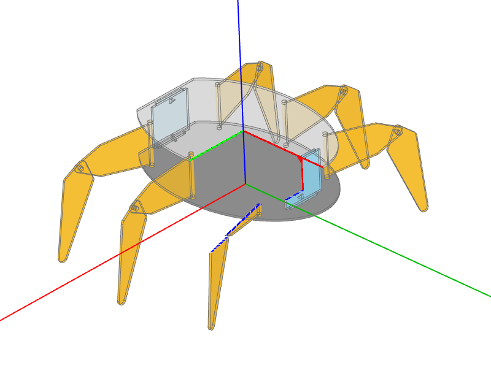

# tcv-screenshots

Headless screenshot generator for three-cad-viewer. Render 3D CAD models to PNG screenshots.

## Supported Platforms

- Linux (Intel, ARM)
- Windows (Intel)
- macOS (Intel, Apple Silicon)

## Installation

```bash
pip install tcv-screenshots
playwright install chromium
```

If you use build123d for creating 3D objects, `build123d` neeeds to be installed, similar for CadQuery.

## Usage

```bash
# Single file (output to current directory)
python -m tcv_screenshots -f example.py

# Single file with output folder
python -m tcv_screenshots -f example.py -o screenshots

# Directory of examples (requires -o)
python -m tcv_screenshots -d examples -o screenshots
```

**Options:**

- `-f, --file FILE` - Single Python example file to process
- `-d, --directory DIR` - Directory containing Python example files (requires -o)
- `-o, --output-folder DIR` - Output directory for PNG screenshots
- `--no-headless` - Show browser window (for debugging)
- `--pause` - Pause before each screenshot (for debugging)
- `--debug MODELS_DIR` - Save JSON model files to directory (for debugging)

## Writing Examples

Create a Python file with a `main()` function that uses `save_model` and returns `get_saved_models()`:

```python
from build123d import *

model = Box(10, 20, 30)

def main():
    from tcv_screenshots import save_model, get_saved_models

    save_model(model, name="box", cad_width=800, height=600)
    return get_saved_models()
```

`save_model(*cad_objs, name, **kwargs)` takes the CAD objects like `show` of [OCP CAD Viewer](https://github.com/bernhard-42/vscode-ocp-cad-viewer), a `name` for the PNG file, and any keyword of `show`, e.g. `colors`, `alphas`, `modes`, `materials`, `render_joints`, `reset_camera` or the `studio_*` options. Both use the same pipeline ([ocp-viewer-core](https://github.com/bernhard-42/ocp-viewer-core)), so the same call gives the same result as in the viewer. Objects with a `material` (e.g. from bd_materials) are rendered with it.

### Multiple Models per Example

For incremental examples that need screenshots at different stages:

```python
from build123d import *

# Step 1: Create base box
box = Box(10, 10, 10)

# Step 2: Add fillet
filleted = fillet(box.edges(), 1)

# Step 3: Add hole
final = filleted - Cylinder(2, 10)

def main():
    from tcv_screenshots import Render, save_model, get_saved_models

    size = {"cad_width": 500, "height": 375}

    save_model(box, name="step1_box", **size)
    save_model(filleted, name="step2_fillet", **size)
    save_model(final, name="step3_hole", modes=[Render.FACES], **size)

    return get_saved_models()
```

This generates `step1_box.png`, `step2_fillet.png`, and `step3_hole.png`.

### Complex Example

```python
from build123d import *

def create_hexapod():
    ...

hexapod = create_hexapod()

def main():
    from tcv_screenshots import save_model, get_saved_models

    save_model(
        hexapod,
        name="hexapod",
        cad_width=800,
        height=600,
        axes=True,
        transparent=True,
        clip_intersection=True,
        clip_slider_0=0,
        clip_slider_1=0,
        clip_slider_2=20,
        tab="clip",
        position=[465.1, 475.9, 463.2],
        quaternion=[0.18, 0.46, 0.80, 0.35],
        target=[-100, -93.4, -9.0],
        zoom=1.2,
    )

    return get_saved_models()
```



### Available Options

Every keyword of `show`, see [OCP CAD Viewer's show command](https://github.com/bernhard-42/vscode-ocp-cad-viewer/blob/main/docs/show.md). The enums used there (`Camera`, `Collapse`, `Render`, `UiTab`, `Studio*`, ...) can be imported from `tcv_screenshots`. `port`, `viewer`, `anchor` and `pinning` address a viewer window and are ignored with a warning.

**Defaults of a screenshot** (override them with the keyword of the same name):

- `cad_width` - Image width (default: 1200, minimum 450)
- `height` - Image height (default: 800)
- `theme` - 'light' or 'dark' (default: 'light')
- `glass` - Glass mode (default: True)
- `tools` - Show tools (default: False)
- `ambient_intensity` - Ambient light intensity (default: 1.0)
- `direct_intensity` - Direct light intensity (default: 1.1)
- `metalness` - Material metalness (default: 0.3)
- `roughness` - Material roughness (default: 0.65)
- `default_edgecolor` - Edge color (default: '#707070')
- `ortho` - Orthographic projection (default: True)
- `up` - Up axis: 'Z' or 'Y' (default: 'Z')
- `reset_camera` - Camera view (default: `Camera.RESET`); also 'iso', 'front', 'rear', 'left', 'right', 'top', 'bottom'

Every screenshot starts with a fresh viewer, so no setting carries over from one screenshot to the next.

Use `--no-headless --pause` to adjust the view by hand; the camera values (`position`, `quaternion`, `target`, `zoom`) are printed before each screenshot and can be passed to `save_model`.

## CI/CD

`tcv_screenshots` can be used in CI/CD workflows, an example can seen in [.github/workflows/screenshots.yml](.github/workflows/screenshots.yml)

## Development

Build the wheel:

```bash
pip install build
python -m build
```
